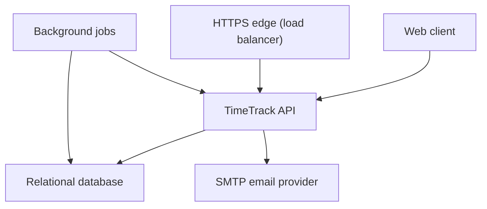
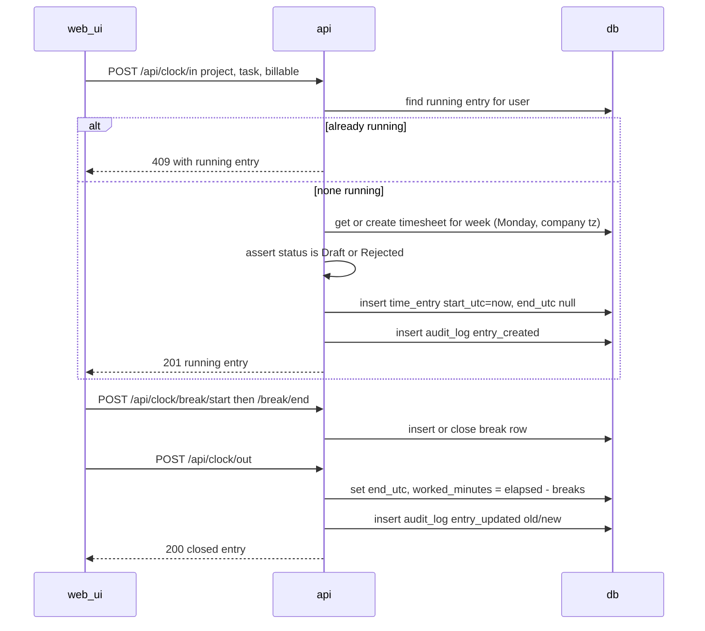
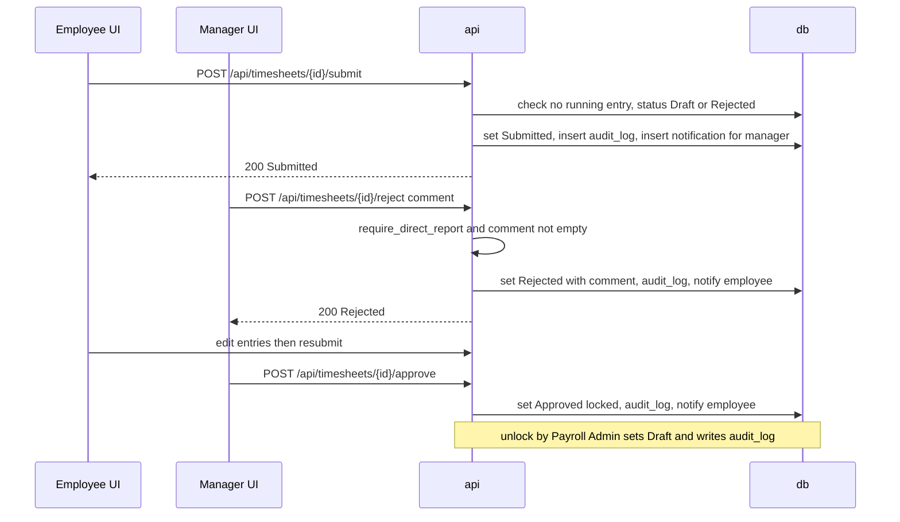
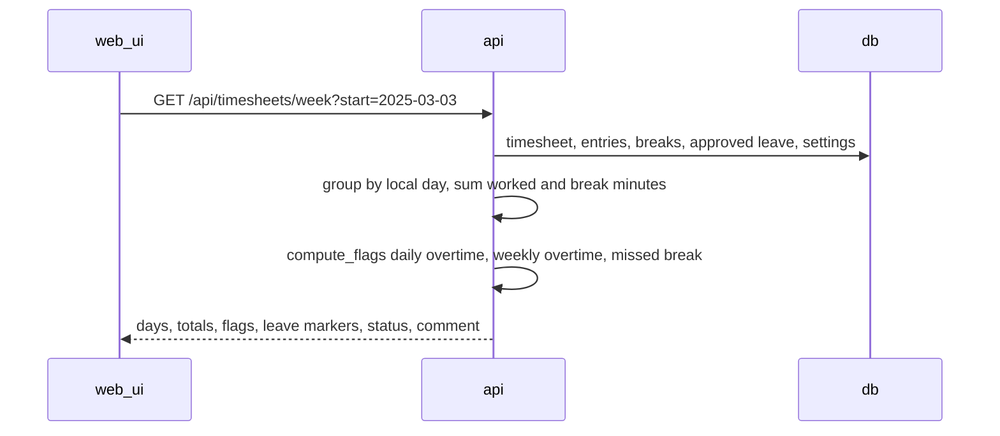
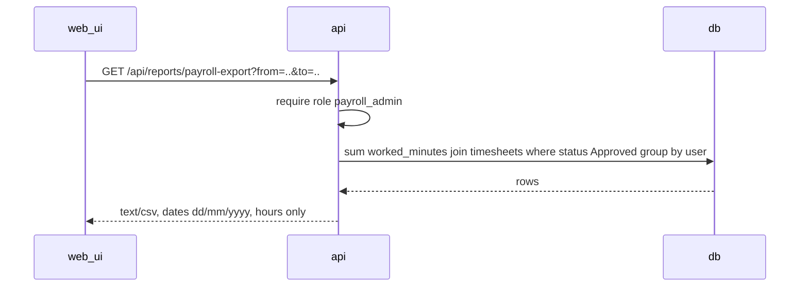
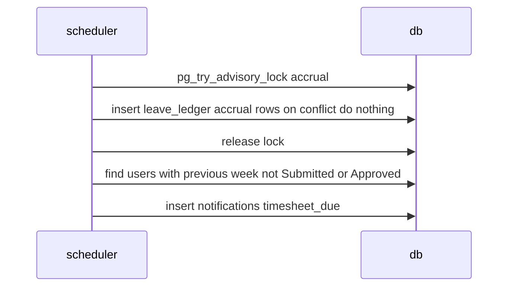
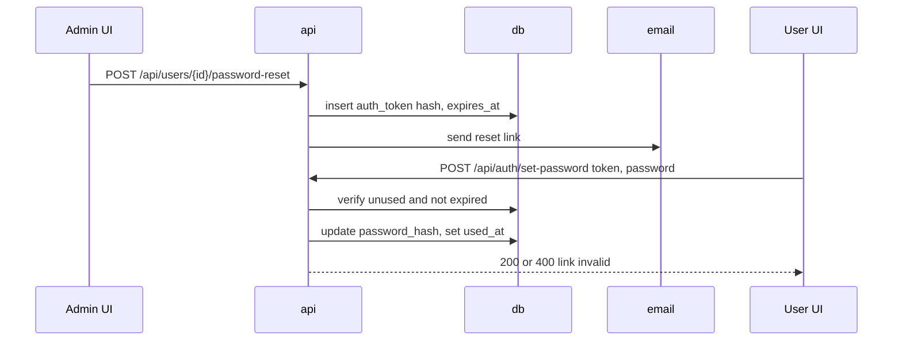
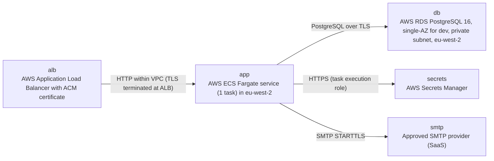

# Architecture

> Maintained by QuorQ AI SDLC. Text between `sdlc:auto` markers is regenerated; anything outside them is yours and is kept.

<!-- sdlc:auto:start narrative -->
## Overview

### ARCH-OVERVIEW · approved · source: architecture:v1

TimeTrack Pro is a single-tenant time and labour web app for one company. It runs as a React 19 client, one FastAPI 0.115 modular-monolith service and one PostgreSQL 16 database on AWS eu-west-2. The architecture is approved at version 1.

- Status: approved. Version: 1.
- Tenancy: single-tenant, one company.
- Stack (approved): React 19 responsive web client, one FastAPI 0.115 service, one PostgreSQL 16 database.
- Hosting: AWS London region (eu-west-2), chosen to meet GDPR and UK GDPR.
- API modules (modular monolith):
  - auth and users
  - clients
  - projects and tasks
  - time tracking (clock and weekly sheet)
  - timesheet approval
  - leave
  - labour-rule flags
  - reports and CSV
  - in-app notifications
  - audit
- In-process scheduler jobs: monthly leave accrual, weekly timesheet-due alerts, 6-year audit retention sweep.
- Email: approved SMTP provider, used only for invite and password-reset links.
- Time handling: all times stored in UTC and shown in one company time zone.
- Working-time flags: computed on read; they never block any action.
- Audit trail: append-only, enforced in the database.
- Deliberately excluded: no cache, queue or extra data store. Stated reason: one app instance and one PostgreSQL database are enough for this company size (up to 500 employees per the project description).

**Related:** ARCH-COMP-WEB_UI, ARCH-COMP-EDGE, ARCH-COMP-API, ARCH-COMP-SCHEDULER, ARCH-COMP-DB, ARCH-COMP-EMAIL

- ⚠ The architecture input does not reference any known requirement key (US-001 to US-033). The links between design elements and user stories cannot be confirmed from this input.
- ⚠ No approval date or approver is recorded for version 1.
- ⚠ The input does not describe monitoring, logging, alerting, backup retention or disaster recovery.
- ⚠ The 6-year audit retention period has no stated rationale or source requirement.

### ARCH-COMP-WEB_UI · approved · source: architecture:v1#components.web_ui

This component is the responsive React 19 single-page client for all four roles. It covers every user-facing screen and shows dates as day/month/year in the company time zone, in English only.

- Technology: React 19 SPA, responsive.
- Serves all four roles: Employee, Manager, Payroll Admin, System Admin.
- Coverage:
  - sign-in, and invite or reset acceptance
  - dashboard
  - clock in/out with breaks
  - Monday-to-Sunday timesheet grid with flags
  - leave requests and balances
  - approval queues
  - reports with CSV download
  - notifications
  - admin settings
- Display rules:
  - dates shown as day/month/year in the company time zone
  - English only
  - never requests location
- Hosting: the static build is served by the API container (see ARCH-TECH-FRONTEND).

**Related:** ARCH-COMP-API, ARCH-TECH-FRONTEND, NFR-015

- ⚠ Screen-level design (screen keys) is not part of this input.

### ARCH-COMP-EDGE · approved · source: architecture:v1#components.edge

This component is the AWS HTTPS edge (load balancer). It terminates TLS, redirects HTTP to HTTPS and routes /api to the API and everything else to the static client.

- Terminates TLS.
- Redirects plain HTTP to HTTPS (NFR-005).
- Routing:
  - /api goes to the API.
  - All other paths go to the static web client.
- Note: the web client is served by the same API container, so both routes reach the same container (see ARCH-DEPLOY-APP).

**Related:** ARCH-DEPLOY-ALB, NFR-005

### ARCH-COMP-API · approved · source: architecture:v1#components.api

This component is the TimeTrack API, a FastAPI 0.115 modular monolith exposing REST endpoints. It handles authentication, authorisation, all domain logic and CSV export, and also serves the built web client.

- Interface: REST endpoints.
- Authentication:
  - password hashes use argon2
  - session is a JWT in an httpOnly cookie
- Authorisation: by role and by direct-report relationship.
- Owns:
  - CRUD for users, clients, projects and tasks
  - clocking and timesheet entries
  - the approval and lock state machine
  - leave requests and the balance ledger
  - labour-rule flag computation
  - reports and CSV export
  - notifications
  - audit writes
- Also serves the built web client as static files.

**Related:** ARCH-COMP-DB, ARCH-COMP-SCHEDULER, ARCH-TECH-BACKEND, ARCH-API-AUTH, ARCH-API-USERS, ARCH-API-CATALOG, ARCH-API-SETTINGS, ARCH-API-CLOCK, ARCH-API-TIMESHEETS, ARCH-API-LEAVE, ARCH-API-NOTIFICATIONS, ARCH-API-REPORTS

- ⚠ Required roles are not stated for most endpoints, for example which admin role manages users, clients, projects or settings. Only unlock (Payroll Admin), payroll export (Payroll Admin), approve/reject (current manager) and report scoping are specified.
- ⚠ JWT expiry, refresh behaviour and CSRF protection for the cookie-based session are not described.
- ⚠ Login throttling or account lockout is not described.

### ARCH-COMP-SCHEDULER · approved · source: architecture:v1#components.scheduler

Background jobs run inside the single API process. They handle leave accrual, timesheet-due alerts, expired token cleanup and the audit retention sweep.

- Runs inside the single FastAPI API process.
- Jobs:
  - monthly leave accrual (idempotent per month)
  - timesheet-due alerts after each Sunday ends in the company time zone
  - cleanup of expired invite and reset tokens
  - daily audit retention sweep that removes only records older than 6 years
- Double-run protection: PostgreSQL advisory lock (see ARCH-PATH-ACCRUAL-ALERTS).

**Related:** ARCH-COMP-API, ARCH-PATH-ACCRUAL-ALERTS, ARCH-COMP-DB

- ⚠ Conflict: the audit retention sweep deletes audit rows, but ARCH-COMP-DB makes audit_log append-only through grants and a trigger. The input does not explain how the sweep is permitted to delete, for example a separate role or a trigger exception.
- ⚠ No frequency is stated for the token cleanup job.

### ARCH-COMP-DB · approved · source: architecture:v1#components.db

PostgreSQL 16 is the system of record for all data. It enforces status locks, referential integrity and unique emails, and keeps the audit table append-only. Report aggregations run as SQL.

- System of record for all data.
- Enforces:
  - status locks
  - the task-to-project composite foreign key
  - unique emails
- Audit table is append-only through grants and a trigger (NFR-010).
- Runs the report aggregations as SQL.

**Related:** ARCH-DATA-MODEL, ARCH-DEPLOY-DB, ARCH-TECH-DATABASE, NFR-010

- ⚠ The mechanism for database-enforced status locks is not described, for example a trigger or constraint.

### ARCH-COMP-EMAIL · approved · source: architecture:v1#components.email

This component is the approved SaaS SMTP provider. It delivers only invite and password-reset link emails.

- Provider: approved SaaS SMTP server.
- Scope: invite and password-reset link emails only (AC-107, AC-086).
- All other notifications are in-app only.

**Related:** ARCH-PATH-INVITE-RESET, ARCH-DEPLOY-SMTP, AC-107, AC-086

- ⚠ The specific SMTP provider is not named.

### ARCH-PATH-CLOCK · approved · source: architecture:v1#critical_paths.clock

This critical path covers clock in, breaks and clock out. A running entry is charged to a project and task with a billable flag, and only one running entry is allowed per user. Worked time is elapsed time minus breaks, and every change is audited.

- Clock in starts a running entry with a project, a task and a billable flag.
- Refuses a second running entry. This is enforced by a partial unique index on time_entries(user_id) WHERE end_utc IS NULL.
- Refuses entries in a week whose timesheet is Submitted or Approved.
- Break rows (entry_breaks) are excluded from worked minutes.
- Clock out closes the entry and computes worked time as elapsed time minus breaks.
- Each change writes an audit row with old and new values.
- No location is captured.

**Related:** ARCH-API-CLOCK, ARCH-COMP-API, ARCH-COMP-DB

- ⚠ Possible discrepancy: the project description says only Approved sheets are locked, but this path also refuses entries in Submitted weeks. This needs confirmation.
- ⚠ audit_log rows are keyed by timesheet_id. The input does not say whether a timesheet row is created automatically when an employee first clocks in for a week.
- ⚠ Handling of an entry still running across midnight or across the week boundary is not described.

### ARCH-PATH-APPROVAL · approved · source: architecture:v1#critical_paths.approval

This critical path is the timesheet state machine for submit, approve, reject and unlock. Only the employee's current manager may approve or reject, and reject requires a comment. Every transition writes audit and notification rows in the same transaction.

- Transitions:
  - Draft or Rejected to Submitted
  - Submitted to Approved or Rejected
  - Approved to Draft by unlock (Payroll Admin only)
- Submit is refused while an entry is running.
- Approve and reject are allowed only for the employee's current manager.
- Reject requires a comment.
- Each transition writes audit and notification rows in the same transaction.
- Flags are informational and never checked as preconditions (NFR-012).

**Related:** ARCH-API-TIMESHEETS, NFR-012

- ⚠ The unlock transition by Payroll Admin is not in the project description, which only says approved sheets are locked. Confirm which requirement it traces to.
- ⚠ The input does not say who acts if an employee has no manager or the manager changes mid-review.
- ⚠ The input does not say whether the employee is notified on unlock.

### ARCH-PATH-WEEKLY-SHEET · approved · source: architecture:v1#critical_paths.weekly_sheet

This path loads a Monday-to-Sunday week in the company time zone. It merges entries, breaks and approved leave, then computes totals and overtime and missed-break flags. The compliance and overtime reports reuse the same flag function.

- The week runs Monday to Sunday in the company time zone.
- The view merges:
  - entries (clocked and manual)
  - breaks
  - approved leave days
- Computes per-day and weekly worked minutes, excluding leave.
- Computes overtime and missed-break flags from the current labour rules (company_settings).
- The compliance and overtime reports reuse the same flag function.

**Related:** ARCH-API-TIMESHEETS, ARCH-API-REPORTS, ARCH-API-SETTINGS

- ⚠ Flags use the current labour rules. The input does not say whether historical weeks are re-flagged when the rules change.
- ⚠ The input does not say whether overtime hours are double-counted when both the daily and weekly limits are exceeded.

### ARCH-PATH-PAYROLL-CSV · approved · source: architecture:v1#critical_paths.payroll_csv

Reports are SQL aggregations scoped by role and streamed as CSV. The payroll export is Payroll Admin only and includes only approved timesheets, with one row per employee per period and no pay amounts.

- SQL aggregation scoped by role:
  - Employees see only themselves.
  - Managers see their direct reports and themselves.
  - Payroll Admins see all.
- Payroll export:
  - Payroll Admin only
  - includes only entries on Approved timesheets
  - one row per employee for the period
  - no pay amounts
  - day/month/year dates
- CSV output is streamed with the Python stdlib csv module.

**Related:** ARCH-API-REPORTS

- ⚠ The payroll 'period' is not defined, for example whether it is weekly, monthly or a custom date range.
- ⚠ System Admin report visibility is not stated.

### ARCH-PATH-ACCRUAL-ALERTS · approved · source: architecture:v1#critical_paths.accrual_alerts

The in-process scheduler runs the monthly leave accrual and the weekly timesheet-due alerts. A PostgreSQL advisory lock and a unique index make the accrual idempotent.

- A PostgreSQL advisory lock prevents double runs.
- Monthly accrual:
  - runs on the 1st of each month in the company time zone
  - inserts one accrual ledger row per active employee per balance-bearing leave type
  - uses the current accrual rate
  - a unique index on (user_id, leave_type_id, accrual_month) makes the run idempotent
  - past rows are never rewritten
- Due alerts: each Monday at 00:00 company time, notifies employees whose previous week is not submitted.

**Related:** ARCH-COMP-SCHEDULER, ARCH-API-LEAVE, ARCH-API-NOTIFICATIONS

- ⚠ The input does not define which leave types are balance-bearing. The project description implies annual leave, but sick and unpaid leave are not specified.
- ⚠ Behaviour for a missed run (app down on the 1st) or for employees who join mid-month is not described.

### ARCH-PATH-INVITE-RESET · approved · source: architecture:v1#critical_paths.invite_reset

Admins create users or trigger password resets, and the API emails a single-use, time-limited token link. Only the SHA-256 hash of the token is stored.

- An admin creates a user or triggers a reset.
- The API stores the SHA-256 hash of a random token, with an expiry of:
  - 48 hours for invites
  - 1 hour for resets
- The link is emailed through SMTP.
- On acceptance, the API:
  - checks the token is unused and unexpired
  - sets the argon2 password hash
  - marks the token used (NFR-003)

**Related:** ARCH-API-AUTH, ARCH-API-USERS, ARCH-COMP-EMAIL, NFR-003

- ⚠ There is no self-service 'forgot password' flow; resets are admin-initiated only. Confirm this matches the requirements.
- ⚠ Password complexity rules are not stated.

### ARCH-DATA-MODEL · approved · source: architecture:v1#entities

The data model has 15 entities covering users and roles, auth tokens, settings, the client/project/task catalogue, timesheets and entries, leave, notifications and audit.

- users: id, email, full_name, password_hash, manager_id, is_active, created_at
- user_roles: user_id, role
- auth_tokens: id, user_id, purpose, token_hash, expires_at, used_at
- company_settings: id, time_zone, currency, daily_limit_minutes, weekly_limit_minutes, break_threshold_minutes, min_break_minutes
- clients: id, name, is_active
- projects: id, client_id, name, bill_rate, is_active
- tasks: id, project_id, name, is_active
- timesheets: id, user_id, week_start, status, reject_comment, submitted_at, decided_by, decided_at
- time_entries: id, timesheet_id, user_id, project_id, task_id, billable, source, work_date, start_utc, end_utc, break_minutes, worked_minutes
- entry_breaks: id, time_entry_id, start_utc, end_utc
- leave_types: id, code, has_balance, accrual_days_per_month
- leave_requests: id, user_id, leave_type_id, start_date, end_date, day_portion, days, status, decided_by, decided_at
- leave_ledger: id, user_id, leave_type_id, kind, days, accrual_month, leave_request_id, created_at
- notifications: id, user_id, kind, payload, created_at, read_at
- audit_log: id, occurred_at, actor_id, timesheet_id, action, old_values, new_values (old/new stored as jsonb per ARCH-TECH-DATABASE)

**Related:** ARCH-COMP-DB

- ⚠ audit_log is keyed to timesheet_id only, so changes to users, settings or leave are not covered by the audit design. This matches the project description's audit scope, which is timesheets only.
- ⚠ timesheets stores only a single reject_comment field. Rejection history across multiple rejections appears to rely on audit_log; this is not confirmed.

### ARCH-API-AUTH · approved · source: architecture:v1#endpoints.auth

These are the authentication endpoints: login, logout, current-user lookup and token-based password setting.

- POST /api/auth/login: email and password sign-in. Returns a generic error on failure and refuses deactivated accounts.
- POST /api/auth/logout: clears the session cookie.
- GET /api/auth/me: returns the current user, roles and unread notification count.
- POST /api/auth/set-password: accepts an invite or reset token (single-use, time-limited).

**Related:** ARCH-PATH-INVITE-RESET, ARCH-COMP-API

### ARCH-API-USERS · approved · source: architecture:v1#endpoints.users

These are the user administration endpoints: list, create with invite, update, and admin-initiated password reset.

- GET /api/users: list users.
- POST /api/users: create a user with roles and a manager, then email an invite. A duplicate email returns 409.
- PATCH /api/users/{id}: update roles, manager or active flag.
- POST /api/users/{id}/password-reset: admin sends a reset link email.

**Related:** ARCH-PATH-INVITE-RESET

- ⚠ The required role is not stated; the project description says 'Admins'.
- ⚠ There is no delete endpoint; deactivation is via the active flag.

### ARCH-API-CATALOG · approved · source: architecture:v1#endpoints.catalog

These endpoints manage clients, projects (with bill rates) and tasks.

- GET /api/clients: list clients with their projects and tasks (active ones for selection lists).
- POST /api/clients: create a client.
- PATCH /api/clients/{id}: edit a client.
- POST /api/projects: create a project with a bill rate.
- PATCH /api/projects/{id}: rename a project, or change its rate or active flag.
- POST /api/tasks: create a task under a project.
- PATCH /api/tasks/{id}: edit a task.

**Related:** ARCH-DATA-MODEL

- ⚠ The input does not say whether a bill rate change applies retroactively to billable-value reports.
- ⚠ The required admin role is not stated.

### ARCH-API-SETTINGS · approved · source: architecture:v1#endpoints.settings

These endpoints read and update company settings: time zone, currency, labour rules and accrual rates.

- GET /api/settings: returns company settings (time zone, currency, labour rules and accrual rates).
- PUT /api/settings: updates settings with validation (no negative values).

**Related:** ARCH-PATH-WEEKLY-SHEET, ARCH-PATH-ACCRUAL-ALERTS

- ⚠ The required role is not stated.
- ⚠ There is no endpoint to create or edit leave types themselves; accrual rates are included in settings.

### ARCH-API-CLOCK · approved · source: architecture:v1#endpoints.clock

These are the clock endpoints for the running entry: state, clock in, break start and end, and clock out.

- GET /api/clock: current running entry and break state.
- POST /api/clock/in: clock in. Returns 409 if already running and 423 if the week is locked. No location is captured.
- POST /api/clock/break/start: start a break.
- POST /api/clock/break/end: end a break.
- POST /api/clock/out: clock out and compute worked minutes.

**Related:** ARCH-PATH-CLOCK

### ARCH-API-TIMESHEETS · approved · source: architecture:v1#endpoints.timesheets

These endpoints cover the weekly sheet, manual entry CRUD, submission, the approval queue, approve/reject/unlock and audit history.

- GET /api/timesheets/week: weekly sheet for self or a visible user, with days, totals, flags, leave and status.
- POST /api/timesheets/{id}/entries: add a manual entry (audited).
- PATCH /api/time-entries/{id}: edit an entry (audited).
- DELETE /api/time-entries/{id}: delete an entry (audited).
- POST /api/timesheets/{id}/submit: submit or resubmit. Refused while an entry is running. Flags never block.
- GET /api/approvals/timesheets: submitted sheets of the manager's direct reports.
- POST /api/timesheets/{id}/approve: approve and lock.
- POST /api/timesheets/{id}/reject: reject. A comment is required.
- POST /api/timesheets/{id}/unlock: unlock an approved sheet (audited).
- GET /api/timesheets/{id}/audit: audit history in time order.

**Related:** ARCH-PATH-WEEKLY-SHEET, ARCH-PATH-APPROVAL

- ⚠ Who may view the audit history is not stated.

### ARCH-API-LEAVE · approved · source: architecture:v1#endpoints.leave

These endpoints cover leave balances, requests and manager decisions. Approved annual leave deducts from the ledger and notifies the employee.

- GET /api/leave/balances: balance, taken and pending per balance-bearing leave type.
- GET /api/leave/requests: own requests, or direct reports' requests for managers, with balances.
- POST /api/leave/requests: request leave. end >= start, and no medical fields.
- POST /api/leave/requests/{id}/decide: approve or reject. Approved annual leave writes a ledger deduction, and the employee is notified.

**Related:** ARCH-PATH-ACCRUAL-ALERTS, ARCH-PATH-WEEKLY-SHEET

- ⚠ Only annual leave is stated to write a ledger deduction. Ledger behaviour for sick and unpaid leave is not specified.
- ⚠ The input does not say whether a request exceeding the available balance is refused or only flagged.
- ⚠ Cancellation of an approved leave request is not covered.

### ARCH-API-NOTIFICATIONS · approved · source: architecture:v1#endpoints.notifications

These endpoints list in-app notifications and mark them read.

- GET /api/notifications: notifications, newest first.
- POST /api/notifications/{id}/read: mark a notification read.
- Notification sources: timesheet transitions, leave decisions and the weekly timesheet-due job.

**Related:** ARCH-PATH-APPROVAL, ARCH-PATH-ACCRUAL-ALERTS

- ⚠ No notification retention or cleanup is described.

### ARCH-API-REPORTS · approved · source: architecture:v1#endpoints.reports

These are the report endpoints for hours, billable split, overtime, leave taken, compliance flags and the payroll export.

- GET /api/reports/hours: hours by employee, project and week.
- GET /api/reports/billable: billable versus non-billable hours and billable value (reporting only).
- GET /api/reports/overtime: overtime hours per employee and week.
- GET /api/reports/leave-taken: approved leave days per employee and type.
- GET /api/reports/compliance: overtime and missed-break flags.
- GET /api/reports/payroll-export: one row per employee with approved hours only and no pay amounts.

**Related:** ARCH-PATH-PAYROLL-CSV, ARCH-PATH-WEEKLY-SHEET

- ⚠ The input does not say whether every report has a CSV variant or only some. The project description requires CSV export for reports.

### ARCH-DEPLOY-ALB · approved · source: architecture:v1#deployment.alb

This node is an AWS Application Load Balancer with an ACM certificate. It serves HTTPS on port 443 and redirects HTTP on port 80 to HTTPS.

- AWS Application Load Balancer.
- ACM certificate.
- HTTPS on 443.
- HTTP on 80 redirects to HTTPS.

**Related:** ARCH-COMP-EDGE, NFR-005

### ARCH-DEPLOY-APP · approved · source: architecture:v1#deployment.app

This node is an ECS Fargate service with one task in eu-west-2. It runs FastAPI on uvicorn, serves the React build and hosts the scheduler.

- AWS ECS Fargate service with 1 task, in eu-west-2.
- Container: FastAPI 0.115 on uvicorn.
- Serves the React 19 static build.
- Runs the in-process scheduler.

**Related:** ARCH-COMP-API, ARCH-COMP-SCHEDULER, ARCH-COMP-WEB_UI

- ⚠ A single task means no redundancy. Availability targets are not stated.
- ⚠ The advisory lock implies multiple instances may run at some point, but scaling plans are not described.

### ARCH-DEPLOY-DB · approved · source: architecture:v1#deployment.db

This node is AWS RDS PostgreSQL 16 in a private subnet in eu-west-2. Storage and backups are encrypted with KMS and TLS is required.

- AWS RDS PostgreSQL 16.
- Single-AZ for dev.
- Private subnet, eu-west-2.
- Storage and backups encrypted with KMS.
- TLS required (rds.force_ssl).

**Related:** ARCH-COMP-DB

- ⚠ Only the dev configuration (single-AZ) is stated. The production RDS configuration, including Multi-AZ and backup retention, is not described.

### ARCH-DEPLOY-SECRETS · approved · source: architecture:v1#deployment.secrets

AWS Secrets Manager holds the database URL, JWT secret and SMTP settings, which are injected into the task as environment variables.

- AWS Secrets Manager.
- Holds DATABASE_URL, JWT_SECRET and SMTP_* values.
- Values are injected as task environment variables.

**Related:** ARCH-DEPLOY-APP

- ⚠ No secret rotation policy is stated.

### ARCH-DEPLOY-SMTP · approved · source: architecture:v1#deployment.smtp

This node is the approved SaaS SMTP provider, reached over STARTTLS.

- Approved SMTP provider (SaaS).
- SMTP over STARTTLS.

**Related:** ARCH-COMP-EMAIL

### ARCH-TECH-FRONTEND · approved · source: architecture:v1#technology.frontend

React 19 was chosen over Vue and Angular for a responsive SPA served as static files by the API container.

- Decision: React 19 (approved).
- Alternatives considered: Vue, Angular.
- Rationale as stated:
  - Built as a responsive SPA covering the weekly grid, clock screen, approval queues and reports.
  - Mobile-first CSS avoids horizontal scrolling on phones (NFR-015).
  - The build is served as static files by the API container, so no separate web host is needed.

**Related:** ARCH-COMP-WEB_UI, NFR-015

- ⚠ No comparison reasoning is given for rejecting Vue or Angular.

### ARCH-TECH-BACKEND · approved · source: architecture:v1#technology.backend

FastAPI 0.115 was chosen over NestJS and Django. Pydantic validation and a single process that also hosts the scheduler fit the single-instance deployment.

- Decision: FastAPI 0.115 (approved).
- Alternatives considered: Node/TypeScript (NestJS), Django.
- Rationale as stated:
  - Pydantic models validate entries, settings and leave requests.
  - One modular-monolith process also hosts the scheduler, which fits the single-instance deployment.

**Related:** ARCH-COMP-API, ARCH-COMP-SCHEDULER

### ARCH-TECH-DATABASE · approved · source: architecture:v1#technology.database

PostgreSQL 16 was chosen over MySQL for relational integrity, SQL aggregation, jsonb audit values and an append-only audit trail enforced by grants and triggers.

- Decision: PostgreSQL 16 (approved).
- Alternatives considered: MySQL.
- Rationale as stated:
  - relational integrity for status locks and the task-to-project FK
  - report aggregations in SQL
  - jsonb for audit old and new values
  - grants plus triggers for an append-only audit trail (NFR-010)

**Related:** ARCH-COMP-DB, NFR-010

### ARCH-TECH-CLOUD · approved · source: architecture:v1#technology.cloud

AWS was chosen over Azure and GCP. It runs ECS Fargate, RDS and an ALB in eu-west-2 for GDPR and UK GDPR data residency.

- Decision: AWS (approved).
- Alternatives considered: Azure, GCP.
- Rationale as stated:
  - runs ECS Fargate, RDS and an ALB in eu-west-2 for GDPR and UK GDPR residency
  - KMS encryption at rest
  - ACM TLS in transit

**Related:** ARCH-DEPLOY-ALB, ARCH-DEPLOY-APP, ARCH-DEPLOY-DB

- ⚠ GDPR obligations beyond data residency and encryption, such as data subject access and erasure, are not addressed in this architecture input. This is noted for human review, not as a legal assessment.
<!-- sdlc:auto:end narrative -->

<!-- sdlc:auto:start building-blocks -->
## Building Block View

| ID | Name | Technology | Responsibility | Depends on |
|---|---|---|---|---|
| web_ui | Web client | React 19 | Responsive single-page UI for all four roles. Covers sign-in and invite or reset acceptance, the dashboard, clock in/out with breaks, the Monday-to-Sunday timesheet grid with flags, leave requests and balances, approval queues, reports with CSV download, notifications and admin settings. It shows dates as day/month/year in the company time zone, English only, and never requests location. | api |
| edge | HTTPS edge (load balancer) | AWS | Terminates TLS and redirects plain HTTP to HTTPS (NFR-005). Routes /api to the API and all other paths to the static web client. | api |
| api | TimeTrack API | FastAPI 0.115 | Modular monolith exposing REST endpoints. Handles authentication (argon2 hashes, JWT in an httpOnly cookie) and role and direct-report authorisation. Owns CRUD for users, clients, projects and tasks, clocking and timesheet entries, the approval and lock state machine, leave requests and the balance ledger, labour-rule flag computation, reports and CSV export, notifications and audit writes. Also serves the built web client as static files. | db, email |
| scheduler | Background jobs | FastAPI 0.115 | Runs inside the single API process. Covers monthly leave accrual (idempotent per month), timesheet-due alerts after each Sunday ends in the company time zone, cleanup of expired invite and reset tokens, and a daily audit retention sweep that removes only records older than 6 years. | api, db |
| db | Relational database | PostgreSQL 16 | System of record for all data. Enforces status locks, the task-to-project composite foreign key and unique emails. Makes the audit table append-only through grants and a trigger. Runs the report aggregations as SQL. | — |
| email | SMTP email provider | SMTP server (approved SaaS) | Delivers invite and password-reset link emails only (AC-107, AC-086). | — |

<!-- sdlc:auto:end building-blocks -->

<!-- sdlc:auto:start runtime -->
## Runtime View

### Clock in, breaks and clock out

Starts a running entry on a project and task with a billable flag. It refuses a second running entry, enforced by a partial unique index on time_entries(user_id) WHERE end_utc IS NULL. It also refuses entries in a week whose timesheet is Submitted or Approved. Break rows are excluded from worked minutes. Clock-out closes the entry and computes worked time as elapsed time minus breaks. Each change writes an audit row with old and new values. No location is captured.

- **Components:** web_ui, api, db
- **Modules:** app/time/clock_service.py, app/time/router.py, app/timesheets/service.py, app/audit/service.py
- **Key functions:** clock_in(user, project_id, task_id, billable), start_break(user), end_break(user), clock_out(user), get_or_create_timesheet(user_id, week_start), assert_editable(timesheet), audit.record(actor, timesheet_id, action, old, new)

### Submit, approve, reject and unlock timesheet

A state machine with these transitions: Draft or Rejected to Submitted, then Submitted to Approved or Rejected, and Approved to Draft by unlock (Payroll Admin only). Submit is refused while an entry is running. Approve and reject are allowed only for the employee's current manager, and reject requires a comment. Each transition writes audit and notification rows in the same transaction. Flags are informational and never checked as preconditions (NFR-012).

- **Components:** web_ui, api, db
- **Modules:** app/timesheets/workflow.py, app/auth/permissions.py, app/notifications/service.py, app/audit/service.py
- **Key functions:** submit(user, timesheet_id), approve(manager, timesheet_id), reject(manager, timesheet_id, comment), unlock(payroll_admin, timesheet_id), require_direct_report(actor, employee_id), notify(user_id, kind, payload)

### Weekly timesheet with flags

Loads a Monday-to-Sunday week in the company time zone. The view merges entries (clocked and manual), breaks and approved leave days. It computes per-day and weekly worked minutes, excluding leave, and the overtime and missed-break flags from the current labour rules. The compliance and overtime reports reuse the same flag function.

- **Components:** web_ui, api, db
- **Modules:** app/timesheets/view.py, app/rules/flags.py, app/leave/service.py
- **Key functions:** load_week(user_id, week_start), compute_flags(day_totals, rules), day_bounds_utc(local_date, tz), approved_leave_days(user_id, start, end)

### Payroll export and CSV reports

SQL aggregation scoped by role. Employees see only themselves, Managers see direct reports and themselves, and Payroll Admins see all. The payroll export is Payroll Admin only. It includes only entries on Approved timesheets, gives one row per employee for the period, contains no pay amounts and uses day/month/year dates. CSV output is streamed with the stdlib csv module.

- **Components:** web_ui, api, db
- **Modules:** app/reports/queries.py, app/reports/csv_writer.py, app/auth/permissions.py
- **Key functions:** visible_user_ids(actor), payroll_export(actor, period_start, period_end), hours_report(actor, filters, fmt), stream_csv(rows, columns)

### Monthly leave accrual and due alerts

An in-process scheduler with a PostgreSQL advisory lock to prevent double runs. On the 1st of each month in the company time zone, it inserts one accrual ledger row per active employee per balance-bearing leave type, using the current accrual rate. A unique index on (user_id, leave_type_id, accrual_month) makes the run idempotent, and past rows are never rewritten. Each Monday at 00:00 company time, it notifies employees whose previous week is not submitted.

- **Components:** scheduler, api, db
- **Modules:** app/jobs/accrual.py, app/jobs/due_alerts.py, app/jobs/retention.py
- **Key functions:** run_monthly_accrual(month), send_timesheet_due_alerts(week_start), purge_audit_older_than(years=6)

### Invite and admin-initiated password reset

An admin creates a user or triggers a reset. The API stores the SHA-256 hash of a random token with a 48-hour (invite) or 1-hour (reset) expiry and emails the link through SMTP. On acceptance it checks the token is unused and unexpired, sets the argon2 hash and marks the token used (NFR-003).

- **Components:** api, db, email, web_ui
- **Modules:** app/auth/tokens.py, app/auth/passwords.py, app/mail/smtp.py
- **Key functions:** issue_token(user_id, purpose, ttl), send_link_email(to, purpose, url), consume_token(raw_token, new_password)

<!-- sdlc:auto:end runtime -->

<!-- sdlc:auto:start deployment-view -->
## Deployment View

| Name | Service | Runtime | Scaling | Environment |
|---|---|---|---|---|
| alb | AWS Application Load Balancer with ACM certificate | HTTPS 443, HTTP 80 redirects to HTTPS | managed | dev |
| app | AWS ECS Fargate service (1 task) in eu-west-2 | Container: FastAPI 0.115 on uvicorn, serving the React 19 static build and running the in-process scheduler | fixed 1 task (NFR-013, NFR-014) | dev |
| db | AWS RDS PostgreSQL 16, single-AZ for dev, private subnet, eu-west-2 | PostgreSQL 16, storage and backups encrypted with KMS, TLS required (rds.force_ssl) | single instance, automated backups | dev |
| secrets | AWS Secrets Manager | Holds DATABASE_URL, JWT_SECRET and SMTP_* values, injected as task env | managed | dev |
| smtp | Approved SMTP provider (SaaS) | SMTP over STARTTLS | external | dev |

| Source | Target | Protocol |
|---|---|---|
| alb | app | HTTP within VPC (TLS terminated at ALB) |
| app | db | PostgreSQL over TLS |
| app | secrets | HTTPS (task execution role) |
| app | smtp | SMTP STARTTLS |

<!-- sdlc:auto:end deployment-view -->

<!-- sdlc:auto:start decisions -->
## Architecture Decisions

| Layer | Choice | ADR |
|---|---|---|
| Frontend | React 19 | [ADR-0001](adr/frontend.md) |
| Backend | FastAPI 0.115 | [ADR-0002](adr/backend.md) |
| Database | PostgreSQL 16 | [ADR-0003](adr/database.md) |
| Cloud | AWS | [ADR-0004](adr/cloud.md) |
<!-- sdlc:auto:end decisions -->

<!-- sdlc:auto:start links -->
## Related Documents

- [Data Model](data-model.md)
- [API Specification](api/openapi.yaml)
- [Architecture Decision Records](adr/README.md)
<!-- sdlc:auto:end links -->
