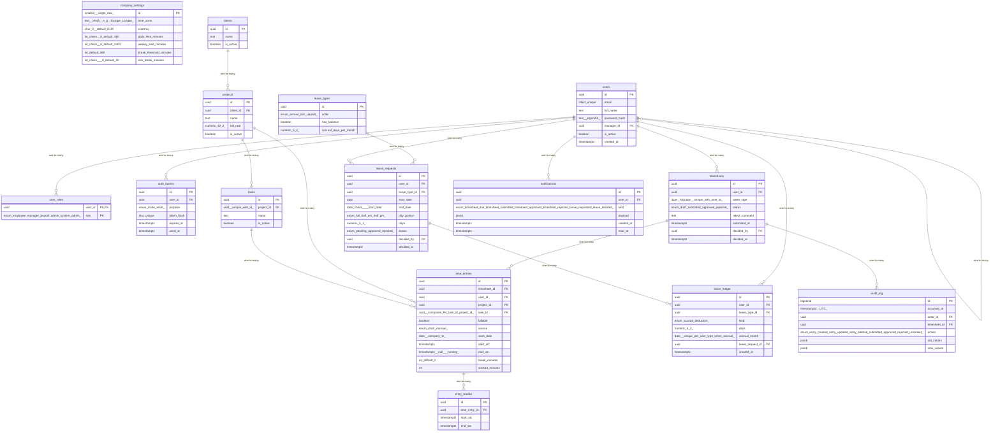

# Data Model

<!-- sdlc:auto:start entities -->
### users

| Field | Type | PK | FK | Nullable |
|---|---|---|---|---|
| id | uuid | True | — | False |
| email | citext unique | False | — | False |
| full_name | text | False | — | False |
| password_hash | text (argon2id) | False | — | True |
| manager_id | uuid | False | users.id | True |
| is_active | boolean | False | — | False |
| created_at | timestamptz | False | — | False |

### user_roles

| Field | Type | PK | FK | Nullable |
|---|---|---|---|---|
| user_id | uuid | True | users.id | False |
| role | enum(employee,manager,payroll_admin,system_admin) | True | — | False |

### auth_tokens

| Field | Type | PK | FK | Nullable |
|---|---|---|---|---|
| id | uuid | True | — | False |
| user_id | uuid | False | users.id | False |
| purpose | enum(invite,reset) | False | — | False |
| token_hash | text unique | False | — | False |
| expires_at | timestamptz | False | — | False |
| used_at | timestamptz | False | — | True |

### company_settings

| Field | Type | PK | FK | Nullable |
|---|---|---|---|---|
| id | smallint (single row) | True | — | False |
| time_zone | text (IANA, e.g. Europe/London) | False | — | False |
| currency | char(3) default EUR | False | — | False |
| daily_limit_minutes | int check >0 default 480 | False | — | False |
| weekly_limit_minutes | int check >0 default 2400 | False | — | False |
| break_threshold_minutes | int default 360 | False | — | False |
| min_break_minutes | int check >=0 default 20 | False | — | False |

### clients

| Field | Type | PK | FK | Nullable |
|---|---|---|---|---|
| id | uuid | True | — | False |
| name | text | False | — | False |
| is_active | boolean | False | — | False |

### projects

| Field | Type | PK | FK | Nullable |
|---|---|---|---|---|
| id | uuid | True | — | False |
| client_id | uuid | False | clients.id | False |
| name | text | False | — | False |
| bill_rate | numeric(10,2) | False | — | True |
| is_active | boolean | False | — | False |

### tasks

| Field | Type | PK | FK | Nullable |
|---|---|---|---|---|
| id | uuid | True | — | False |
| project_id | uuid (unique with id) | False | projects.id | False |
| name | text | False | — | False |
| is_active | boolean | False | — | False |

### timesheets

| Field | Type | PK | FK | Nullable |
|---|---|---|---|---|
| id | uuid | True | — | False |
| user_id | uuid | False | users.id | False |
| week_start | date (Monday, unique with user_id) | False | — | False |
| status | enum(draft,submitted,approved,rejected) | False | — | False |
| reject_comment | text | False | — | True |
| submitted_at | timestamptz | False | — | True |
| decided_by | uuid | False | users.id | True |
| decided_at | timestamptz | False | — | True |

### time_entries

| Field | Type | PK | FK | Nullable |
|---|---|---|---|---|
| id | uuid | True | — | False |
| timesheet_id | uuid | False | timesheets.id | False |
| user_id | uuid | False | users.id | False |
| project_id | uuid | False | projects.id | False |
| task_id | uuid (composite FK task_id,project_id) | False | tasks.id | False |
| billable | boolean | False | — | False |
| source | enum(clock,manual) | False | — | False |
| work_date | date (company tz) | False | — | False |
| start_utc | timestamptz | False | — | True |
| end_utc | timestamptz (null = running) | False | — | True |
| break_minutes | int default 0 | False | — | False |
| worked_minutes | int | False | — | True |

### entry_breaks

| Field | Type | PK | FK | Nullable |
|---|---|---|---|---|
| id | uuid | True | — | False |
| time_entry_id | uuid | False | time_entries.id | False |
| start_utc | timestamptz | False | — | False |
| end_utc | timestamptz | False | — | True |

### leave_types

| Field | Type | PK | FK | Nullable |
|---|---|---|---|---|
| id | uuid | True | — | False |
| code | enum(annual,sick,unpaid) | False | — | False |
| has_balance | boolean | False | — | False |
| accrual_days_per_month | numeric(5,2) | False | — | True |

### leave_requests

| Field | Type | PK | FK | Nullable |
|---|---|---|---|---|
| id | uuid | True | — | False |
| user_id | uuid | False | users.id | False |
| leave_type_id | uuid | False | leave_types.id | False |
| start_date | date | False | — | False |
| end_date | date check >= start_date | False | — | False |
| day_portion | enum(full,half_am,half_pm) | False | — | False |
| days | numeric(5,1) | False | — | False |
| status | enum(pending,approved,rejected) | False | — | False |
| decided_by | uuid | False | users.id | True |
| decided_at | timestamptz | False | — | True |

### leave_ledger

| Field | Type | PK | FK | Nullable |
|---|---|---|---|---|
| id | uuid | True | — | False |
| user_id | uuid | False | users.id | False |
| leave_type_id | uuid | False | leave_types.id | False |
| kind | enum(accrual,deduction) | False | — | False |
| days | numeric(5,2) | False | — | False |
| accrual_month | date (unique per user,type when accrual) | False | — | True |
| leave_request_id | uuid | False | leave_requests.id | True |
| created_at | timestamptz | False | — | False |

### notifications

| Field | Type | PK | FK | Nullable |
|---|---|---|---|---|
| id | uuid | True | — | False |
| user_id | uuid | False | users.id | False |
| kind | enum(timesheet_due,timesheet_submitted,timesheet_approved,timesheet_rejected,leave_requested,leave_decided) | False | — | False |
| payload | jsonb | False | — | False |
| created_at | timestamptz | False | — | False |
| read_at | timestamptz | False | — | True |

### audit_log

| Field | Type | PK | FK | Nullable |
|---|---|---|---|---|
| id | bigserial | True | — | False |
| occurred_at | timestamptz (UTC) | False | — | False |
| actor_id | uuid | False | users.id | False |
| timesheet_id | uuid | False | timesheets.id | False |
| action | enum(entry_created,entry_updated,entry_deleted,submitted,approved,rejected,unlocked) | False | — | False |
| old_values | jsonb | False | — | True |
| new_values | jsonb | False | — | True |
<!-- sdlc:auto:end entities -->

<!-- sdlc:auto:start relationships -->
| Source | Target | Type |
|---|---|---|
| users | users | one-to-many |
| users | user_roles | one-to-many |
| users | auth_tokens | one-to-many |
| clients | projects | one-to-many |
| projects | tasks | one-to-many |
| users | timesheets | one-to-many |
| timesheets | time_entries | one-to-many |
| projects | time_entries | one-to-many |
| tasks | time_entries | one-to-many |
| time_entries | entry_breaks | one-to-many |
| leave_types | leave_requests | one-to-many |
| users | leave_requests | one-to-many |
| users | leave_ledger | one-to-many |
| leave_requests | leave_ledger | one-to-many |
| users | notifications | one-to-many |
| timesheets | audit_log | one-to-many |
<!-- sdlc:auto:end relationships -->

<!-- sdlc:auto:start er-diagram -->

<!-- sdlc:auto:end er-diagram -->
