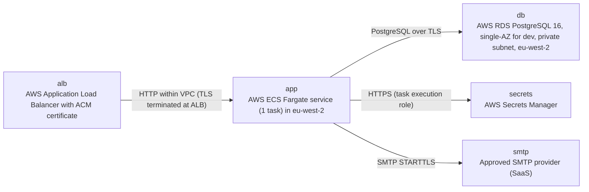

# Deployment Guide

> Maintained by QuorQ AI SDLC. Text between `sdlc:auto` markers is regenerated; anything outside them is yours and is kept.

<!-- sdlc:auto:start how-it-deploys -->
Pushes to `main` run `.github/workflows/deploy.yml`, which builds the API image (if there is a backend) and deploys the SPA to AWS Amplify. Commits touching only `docs/sdlc/**` don't deploy. Deployments can also be started from the platform's Deployment tab.
<!-- sdlc:auto:end how-it-deploys -->

<!-- sdlc:auto:start environments -->
| Name | Service | Runtime | Scaling | Environment |
|---|---|---|---|---|
| alb | AWS Application Load Balancer with ACM certificate | HTTPS 443, HTTP 80 redirects to HTTPS | managed | dev |
| app | AWS ECS Fargate service (1 task) in eu-west-2 | Container: FastAPI 0.115 on uvicorn, serving the React 19 static build and running the in-process scheduler | fixed 1 task (NFR-013, NFR-014) | dev |
| db | AWS RDS PostgreSQL 16, single-AZ for dev, private subnet, eu-west-2 | PostgreSQL 16, storage and backups encrypted with KMS, TLS required (rds.force_ssl) | single instance, automated backups | dev |
| secrets | AWS Secrets Manager | Holds DATABASE_URL, JWT_SECRET and SMTP_* values, injected as task env | managed | dev |
| smtp | Approved SMTP provider (SaaS) | SMTP over STARTTLS | external | dev |
<!-- sdlc:auto:end environments -->

<!-- sdlc:auto:start live -->
**Frontend URL:** https://pb05224319b77.d3j61xaup4zgrx.amplifyapp.com

**Backend URL:** https://32-189-101-24.sslip.io/apps/b05224319b77/

**Database:** PostgreSQL · app

**Version:** a08a3ea55954

**Commit:** `a08a3ea`

**Finished:** 2026-11-04
<!-- sdlc:auto:end live -->

<!-- sdlc:auto:start topology -->

<!-- sdlc:auto:end topology -->
